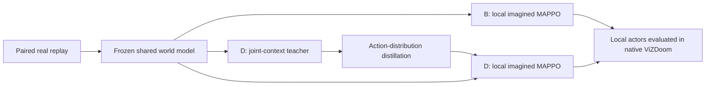

# Shared Imagination and Policy Distillation for Decentralized Visual Cooperation

**SC4001 Deep Learning Research Project· Xu Zixuan, Chong Bo Yu and Chew Yee Chen**

[Read our written paper (PDF)](SC4001%20Initial%20Draft.pdf) 

This project investigates whether a teacher with access to joint world-model
representations can improve cooperation between agents that must act from local
visual observations. We implement a shared stochastic Transformer world model,
recurrent decentralized policies, imagined multi-agent PPO, and teacher-to-student
action-distribution distillation in a custom two-player ViZDoom environment.

**The reduced study is complete.** In the completed Relay comparison, distillation
improved agreement with the teacher on its training buffers, but neither method
achieved native task success. The results support an exploratory negative finding
under the tested configuration; successful transfer remains unestablished.

## Research question

> With fixed real replay, a shared frozen world model and matched local PPO
> budgets, does a teacher-distilled initialization improve final native
> cooperation over direct local learning in imagination?

The work brings together three research components:

- **Shared imagination:** both agents' trajectories are generated from one
  shared stochastic world state.
- **Strict decentralized execution:** each deployed actor uses only its own RGB
  observations, previous actions and separate recurrent memory.
- **Controlled teacher transfer:** paired runs isolate the complete teacher-training
  and distillation procedure as an addition to a common local-learning budget,
  while recording its extra computation.

The completed experiment measures final performance at one fixed data budget.
It does not measure an online sample-efficiency learning curve.

## Methods

| | B: direct local learning | D: teacher-guided initialization |
|---|---|---|
| Initial replay and world model | Shared within each seed pair | Same as B |
| Policy initialization | Paired local actor and critic parameters | Same initial local parameters as B |
| Before local PPO | No teacher stage | Train a joint-context teacher, then distill its action distributions |
| Local policy learning | Recurrent MAPPO in imagination | The same local PPO budget after distillation |
| Inputs at deployment | Own RGB, previous action and local recurrent state | Identical restrictions |

The world model learns from synchronized joint transitions. Real replay prefixes
reconstruct model and actor states before short autonomous imagined rollouts.
Local CNN/GRU actors train with a centralized critic; the critic and world model
are absent from deployed actor inputs.

D's teacher can attend to joint latent tokens inferred from visual histories.
This is training-only model context, rather than direct access to true simulator
state. Forward-KL distillation transfers the teacher's action probabilities to
local students. Subsequent local PPO uses fresh optimizers, with no teacher
queries, continuing teacher loss or guidance-decay schedule.



## Environment and completed experiment

**Relay** is a project-authored cooperative ViZDoom scenario: the two players
must coordinate pressure-plate and gate mechanics, activate a latch, and reach
extraction alive within a 400-joint-decision episode. The repository also implements
**Cover**, a combat-and-console task used in earlier data collection and model
diagnostics. Cover is outside the final B-versus-D policy comparison.

| Experimental choice | Completed protocol |
|---|---|
| Task and training seeds | Relay; seeds 0 and 1 |
| Comparative runs | B and D for each seed: four runs |
| Initial real replay | 50,000 synchronized joint transitions per seed, reused by B and D |
| Replay split | Deterministic 90%/10% episode split for fitting and diagnostics |
| Initial world-model fit | 4,500 optimizer updates per Relay model |
| Model and replay during policy training | Frozen; no new real training collection or model updates |
| Local PPO budget | 20 cycles per run; 320 actor and 320 critic optimizer steps |
| Imagination | 256 starts per cycle; maximum horizon of 15 joint steps |
| Additional D stages | 25 teacher PPO cycles, 128 distillation trajectories, 100 supervised updates |
| Final native evaluation | 20 episodes per actor: 10 on each of two held-out test layouts |
| Primary outcome | Final team success rate; descriptive paired differences |

A joint transition advances both players together and is counted once.
The replay split is by episode, so its transition proportions need not be
exactly 90%/10%. Model diagnostics on training geometry are separate from native
evaluation on held-out layouts.

The [fixed-data configuration](configs/studies/relay_four_day_v1.yaml) and
[endpoint protocol](configs/studies/relay_endpoint_protocol_v1.yaml) define this
comparison. Earlier online development schedules are retained as historical
configurations and are not part of these four runs.

## Results

All four actors completed their registered training schedules and native test
banks. Across all 80 evaluation episodes, every episode reached the deadline;
no actor activated the latch or completed Relay.

| Method | Seed | Successes | Episodes with latch activation | Mean return | Mean episode length |
|---|---:|---:|---:|---:|---:|
| B | 0 | 0/20 | 0/20 | -1.40 | 400 joint decisions |
| D | 0 | 0/20 | 0/20 | -1.40 | 400 joint decisions |
| B | 1 | 0/20 | 0/20 | -1.40 | 400 joint decisions |
| D | 1 | 0/20 | 0/20 | -1.40 | 400 joint decisions |

Distillation did optimize its supervised objective:

| D run | Training-buffer forward KL before | After 100 updates |
|---|---:|---:|
| Seed 0 | 0.3384 | 0.0133 |
| Seed 1 | 0.3525 | 0.0174 |

These measurements use the same teacher buffers before and after distillation.
They do not establish held-out imitation, retained teacher agreement after PPO,
or successful real-environment behavior.

| Run | Generated imagined joint steps | Recorded training-unit elapsed hours |
|---|---:|---:|
| B, seed 0 | 75,125 | 2.427 |
| D, seed 0 | 165,710 | 4.265 |
| B, seed 1 | 75,516 | 2.475 |
| D, seed 1 | 164,097 | 4.326 |

The total is **480,448 imagined joint steps**. D's counts include teacher rollouts
and distillation-buffer generation as well as local PPO. Recorded durations are
sums of elapsed training units, not measured GPU occupancy or total campaign
wall time.

### Interpretation and limitations

The observed D-minus-B differences in success, return and latch rate are zero
for both seeds. A common performance floor with two training seeds does not
establish equivalence or show that teacher guidance is generally ineffective.

The main limits are:

- One final task family selected after model diagnostics, two reused development
  seeds and two authored test layouts.
- Incomplete formal world-model qualification; image prediction alone does not
  establish reliable action effects, rewards or terminal events.
- No native teacher-competence benchmark or held-out imitation evaluation.
- Additional teacher computation in D: local PPO is matched, total compute is not.
- No component ablation that identifies the cause of failure.
- A single final evaluation budget, with no demonstrated sample-efficiency gain.

The completed study distinguishes implementation and evidence completeness from
learned competence. Earlier development runs and Cover diagnostics remain
separate from the comparative results.

## Written paper

**[Shared Imagination and Policy Distillation for Decentralized Visual Cooperation — PDF](SC4001%20Initial%20Draft.pdf)**

Authors: Xu Zixuan, Chong Bo Yu and Chew Yee Chen.

The linked document is the team's **initial written draft**, not a peer-reviewed
publication. The protocol and result summary above describe the completed reduced
study; the draft remains subject to revision.

## Repository guide

| Location | Contents |
|---|---|
| [`src/world_models/`](src/world_models/) | Environment interfaces, replay, world model, policies and core training |
| [`src/world_models_campaign/`](src/world_models_campaign/) | Integrated teacher, distillation and refinement controller |
| [`src/world_models_paired/`](src/world_models_paired/) | Matched B/D training support |
| [`src/world_models_study/`](src/world_models_study/) | Static protocol, input binding and test-bank registration |
| [`src/world_models_endpoint/`](src/world_models_endpoint/) | Frozen cohort orchestration, accounting, final evaluation and paired analysis |
| [`src/world_models_acceptance/`](src/world_models_acceptance/) | Phase 4 integration and local-deployment engineering checks |
| [`scenarios/`](scenarios/) | Authored Relay/Cover scenario sources and probes |
| [`configs/`](configs/) | Architectures, task geometry, seeds and study protocols |
| [`scripts/`](scripts/) | Phase-specific command-line entry points |
| [`tests/`](tests/) | Unit and integration checks |
| [`study_reporting/`](study_reporting/) | Saved-result diagnostics, accounting, figures and cohort-completion checks |
| [`study_release/`](study_release/) | Trace review, packaging and saved-record reproduction |
| [`study_paper/`](study_paper/) | Manuscript tables and claim-to-evidence checks |
| [`docs/`](docs/) | Architecture descriptions and operator guides |
| [`artifacts/README.md`](artifacts/README.md) | Model, dataset and research-archive inclusion policy |

## Setup and reproduction

Use **Python 3.12** for the recorded development stack. Run commands from the
repository root. The following prepares the lightweight configuration and
infrastructure checks.

**Linux / Bash**

```bash
python3.12 -m venv .venv
source .venv/bin/activate
python -m pip install -r requirements-phase0.lock
python -m pip install --no-build-isolation -e .
python -m scripts.phase0 check --output artifacts/local_check/phase0_acceptance.json
```

**Windows / PowerShell**

```powershell
py -3.12 -m venv .venv
.\.venv\Scripts\python.exe -m pip install -r requirements-phase0.lock
.\.venv\Scripts\python.exe -m pip install --no-build-isolation -e .
.\.venv\Scripts\python.exe -m scripts.phase0 check --output artifacts/local_check/phase0_acceptance.json
```

Additional dependencies are separated by purpose:

| Work | Dependency file / guide |
|---|---|
| Native ViZDoom environment and scenario compiler | [Phase 1 dependencies](requirements-phase1.lock) and [environment guide](docs/phase1_complete.md) |
| Model/policy implementation checks on CPU | [CPU dependency lock](requirements-phase2-cpu.lock) |
| Linux GPU training | [GPU dependency recipe](requirements-linux-gpu.txt); its pinned CUDA wheel requires a compatible driver/runtime |
| Saved-results reporting and packaging | [Reporting dependencies](study_reporting/requirements.txt) and [release dependencies](study_release/requirements.txt) |

For research execution, follow the existing guides in order:

1. [Replay collection](docs/phase21_replay.md), [model fitting/selection](docs/phase24_training.md) and [model diagnostics](docs/phase25_validation.md).
2. [Protocol registration](docs/phase51_protocol.md), then [paired training and final evaluation](docs/phase5_study.md).
3. [Result reporting and accounting](docs/phase5_completion.md).
4. [Diagnosis, release packaging and saved-record reproduction](docs/phase6_release.md).

The operator guides retain historical server paths and expected artifact
locations. Adapt paths to your environment and restore the required inputs before
execution. Core checks do not launch research training. Model/policy training
uses the GPU environment; the completed study's native endpoint evaluation ran
on CPU, and saved-record reporting needs no GPU.

### Available files and reproduction boundary

Source, tests, configurations, dependency files and the linked written paper are
intended for the repository. Model weights and checkpoints are configured for
**Git LFS**; a weights download requires the corresponding LFS objects. For a
source-only clone, Git LFS supports skipping automatic model downloads with
`GIT_LFS_SKIP_SMUDGE=1`.

**Datasets are excluded**, including real replay and synthetic distillation
buffers. Generated research reports, evaluation records, working manuscripts
and sealed releases also remain outside Git. The root written-paper PDF is the
explicit exception to the working-paper exclusion.

Consequently, a source/LFS clone is not the complete experiment archive.
Retraining requires the original replay, selected checkpoints, normalization
and registration metadata, or a separately registered fresh collection.
Reproducing the original tables and figures requires the saved evaluation
records and sealed release. Preserve their manifests and SHA-256 receipts.
The saved-record workflow reproduces six CSV tables and two figures without
retraining or opening the simulator.

## Citation

If referring to this project or its draft, a suggested citation is:

```bibtex
@misc{xu2026sharedimagination,
  title        = {Shared Imagination and Policy Distillation for Decentralized Visual Cooperation},
  author       = {Xu, Zixuan and Chong, Bo Yu and Chew, Yee Chen},
  year         = {2026},
  howpublished = {SC4001 research project, initial draft},
  url          = {https://github.com/zacxu/SC4001_World_models}
}
```
