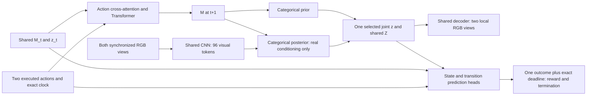

# P2.2: shared stochastic Transformer architecture

P2.2 is complete. The implementation follows the approved architecture and uses
the sealed P2.1 pilot replay without modifying or recollecting it. This step
establishes an **untrained** model and tested interfaces. It does not establish
useful reconstruction, dynamics fidelity, cooperation, or policy performance.
P2.3 [objectives and fitting statistics](phase23_objectives.md) are now completed.
P2.4 fits the model, and P2.5 assesses prediction quality.

The measured [verification report](../artifacts/phase22/phase22_acceptance.json)
contains source hashes, architecture counts, test results, and replay provenance.
The [full suite report](../artifacts/phase22/regression_tests.json) records the
existing environment/data tests alongside the architecture tests.

Measured validation: **38 architecture tests passed**; the full suite ran 327
tests with **326 passed and one skipped** because Windows symlink privileges
were unavailable. Read-only checks covered all four pilot stores and 4,261
transition labels in 14 fitting episodes. Dependency consistency and the Git
diff check passed. These are implementation checks, not trained-model results.



The prior and posterior are alternative conditioning paths for the selected
destination latent. Autonomous imagination uses the prior path exclusively.

## Components and shapes

Let B denote the sequence batch, V=2 views, and A=12 executable actions. State
index j is the number of completed joint decisions; transition j uses actions
at j and produces the state at j+1. State supervision always follows its
observation index. Event, bonus, and outcome supervision follows the transition.

| Component | Implemented shape and operation |
|---|---|
| Input | `uint8[B,2,3,96,128]` or finite floating `[0,1]`; converted to float32 before encoder/autocast |
| Shared encoder | Conv2d `3→32→64→128→256`, each kernel 4, stride 2, padding 1; GroupNorm(8) and SiLU after each |
| Spatial grid | `32×48×64 → 64×24×32 → 128×12×16 → 256×6×8` per view |
| Visual tokens | `B×2×48×256`; learned spatial and view-identity embeddings; 96 tokens jointly |
| Shared deterministic M | `B×16×256`; learned reset memory, shared by both players |
| Shared stochastic z | `B×32×32` one-hot categorical forward values, straight-through probability gradients |
| Latent projection P | Flatten 32×32 and project linearly to 16×256 |
| Action aggregation | Two executed action embeddings plus view IDs, eight-head cross-attention queried by the shared memory |
| Progress | MLP of exact `j/deadline`, added to transition and posterior context |
| Dynamics | Four pre-norm Transformer blocks, width 256, eight heads, FFN 1,024, GELU, dropout zero, final LayerNorm |
| Prior | Memory mean → LayerNorm/MLP → `B×32×32` raw logits |
| Posterior | Memory queries cross-attend to both views' tokens; pooled residual → LayerNorm/MLP → `B×32×32` raw logits |
| Shared representation Z | Concatenate 16 memory tokens and 32 embedded stochastic-variable tokens: `B×48×256` |
| Decoder | Learned 6×8 spatial queries plus view ID attend the same Z; one shared transposed-convolution CNN `256→128→64→32→3` |
| Generated RGB | `B×2×3×96×128`, sigmoid `[0,1]`; upsampling uses kernel 4, stride 2, padding 1, with GroupNorm/SiLU in hidden layers |
| Transition context | Concatenate pooled source Z, projected **ordered** joint-action tokens, and pooled destination Z: `B×768` |
| Bonus and outcome | Two-layer width-256 SiLU trunk, bounded sigmoid bonus and categorical continue/success/failure logits |
| State auxiliary heads | Pooled Z → two-layer MLP → per-field outputs; continuous values, binary logits, categorical stage logits |
| Event auxiliary heads | Transition context → two-layer MLP → per-event presence logits |

Kernel/padding, GroupNorm/SiLU, the decoder channel sequence, pooled readouts,
48-token Z construction, and zero dropout resolve details left open in the
approved pilot specification. They are implementation choices, not results or
new B/D variants. Only the shared world-model encoder is implemented here;
actor-specific encoders and recurrent memories belong to Phase 3.

Both reconstruction views and all heads use the **same destination state and
categorical sample**. This avoids independently sampling two worlds. It does
not guarantee physical agreement among learned outputs; P2.5 must measure that.
This is a categorical variational recurrent model; it has no VQ codebook or
separate pretrained image tokenizer. Losses and KL reduction are implemented
in [P2.3](phase23_objectives.md).

## Probability and random streams

`categorical_probs(logits, uniform_mixture)` always computes float32 softmax
probabilities, then mixes `(1-u)*p + u/32`, with default u=0.01. P2.3 uses this
same helper for both distributions in KL. The forward sample is one-hot and
the backward path follows these mixed probabilities.

`SamplingStreams` holds independent prior, posterior, and outcome generators.
Each has explicit state save/restore. Sampling does not use the global torch
generator. Model initialization uses the Phase 0 paired seed namespace and a
temporary CPU RNG context; it preserves unrelated CPU and CUDA streams. Model
construction is on CPU; moving to a device is explicit. Generators must be
created on the sampling device.

`observe_step` currently draws a candidate prior sample and, for rows with both
views available, a replacement posterior sample from its separate stream.
Only the selected destination sample supplies both views and every head. The
unused candidate prior is retained with its logits for later KL/diagnostics;
there is no separate sample per agent. Autonomous steps draw one joint latent
and one joint outcome. Outcome probabilities use ordinary float32 softmax,
**without** the latent's 1% uniform mixture.

## Entry points and masking

Code lives in [core.py](../src/world_models/models/core.py),
[heads.py](../src/world_models/models/heads.py), and
[world_model.py](../src/world_models/models/world_model.py).

```python
import torch
from world_models.infrastructure.config import resolve_config
from world_models.models.world_model import SamplingStreams, build_model

cfg = resolve_config("relay", "B", "pilot").settings
model = build_model(cfg, master_seed=0, variant="B")
streams = SamplingStreams.from_seed(100, device="cpu")
# rgb: uint8 [batch,2,3,96,128], joint_actions: long [batch,2].
state = model.initialize(rgb, streams=streams)
initial_prediction = model.reconstruct(state)
observed = model.observe_step(state, joint_actions, next_rgb, streams=streams,
                             next_image_valid=next_image_valid)
# observed.prior.logits and observed.state.logits are available for P2.3.
# observed.posterior_valid masks KL, independently of reward/state masks.
with torch.no_grad():
    imagined = model.imagine(observed.state, fixed_joint_actions, streams=streams)
# fixed_joint_actions: long [horizon,batch,2]. Respect each step.valid mask.
```

`initialize` infers z_0 from the first synchronized pair of valid images and
uses learned M_0. `reconstruct` supplies RGB and state predictions without a
preceding transition target. `observe_step` produces a prior then incorporates
real destination images only when **both views** are valid. A missing view
retains the joint prior for that row and sets `posterior_valid=False`; invalid
image padding never enters the CNN. Later losses must still apply each image
and auxiliary field's independent validity mask.

`ModelTransition.auxiliary` contains **destination** state predictions and
current-transition event predictions. Match state targets to j+1 and events to
j. Use `reconstruct(state_j).auxiliary` when supervising state j. The adapters
do not implicitly shift arrays. Keep both the prior logits and selected
posterior logits when forming the later balanced KL.

`start_imagination` detaches the anchor and initializes `ended=False`. The caller
must select a nonterminal fitting-replay source state. Complete-prefix anchor
reconstruction and model-version cache keys belong to Phase 3. `imagine_step`
accepts only an imagination state, joint actions, and RNG streams. It has no
route for future real images, engine state, or privileged labels. Generated
images are decoder outputs; they are not re-encoded as real evidence.

For a batched rollout, only active rows advance or consume samples. Finished
rows keep their state and clock; their outputs are padding with `valid=False`
and reward zero. `terminated` marks new valid terminations; `next.ended` is
cumulative. Once all rows end the rollout stops; manually stepping an all-ended
batch raises an error. A horizon cutoff itself is not a task outcome or a
failure reward. Policy bootstrap semantics remain Phase 3 work.

## Rewards, outcome, and exact clocks

Task constants are read from resolved task configuration. Default relay and
cover deadlines are 400 and 600 joint decisions. Milestone bonuses are 0.1 for
relay's one milestone and 0.05 each for cover's two milestones. The conservative
per-transition bonus bound is 0.1 for both tasks, matching the environment's
reward contract. A bounded expectation does not itself enforce one-time
milestone use across a rollout; this remains an event/dynamics accuracy issue
for training and validation.

One sampled outcome has this precedence:

1. Sampled non-deadline failure → terminal failure.
2. Otherwise sampled success → terminal success, including at the deadline.
3. Otherwise clock j+1 at the deadline → terminal deadline failure.
4. Otherwise continue.

The terminal reward is +1 for success, -1 for failure/deadline, zero otherwise.
Total reward is bounded milestone prediction −0.001 + terminal reward.
Termination and this reward component share the same resolved outcome.
Death labels count as non-deadline failure. A real deadline-only label trains
the learned outcome as **continue**; the clock supplies failure. A collection
cutoff also labels continue and carries no failure penalty.

`encode_transition_targets` checks reason, source clock, optional terminated/
truncated flags, and reward decomposition. It rejects bonuses outside the
declared range, with only 1e-6 assertion tolerance for roundoff. Terminal-image
availability never invalidates a valid reward/outcome label.

## Auxiliary targets

Field declarations derive from the P1/P2.1 player/task/enemy/event schema.
Relay exposes 55 fields: 22 continuous state, nine binary state, one categorical
stage, and 23 binary transition event-presence outputs. Cover exposes 64:
30 continuous state, 11 binary state, one stage, and 22 event-presence outputs.
Stage has **three classes for relay and four for cover**, including successful
terminal stages. Family-inapplicable fields are omitted.

Player fields include position, velocity, health, armor, ammo, heading sin/cos,
and alive. Cover also declares enemy positions/health/alive/spawned. Existing
geometry-normalized arrays supply continuous adapter values. **Fitting-only
normalization statistics are now frozen in P2.3**, and continuous heads predict
their standardized targets. Binary events represent `event_delta>0`; native event counts can
exceed one but their current prediction target is presence, as requested by
P2.2. Raw counts remain in immutable replay for later diagnostics.

Privileged arrays and masks enter target adapters only. They never enter the
image encoder, posterior, prior, or autonomous transition. Missing fields keep
their own false masks, independently of image/reward validity.

## Reproduce verification

The measured stack is Windows, Python 3.12, PyTorch 2.15.0+cpu, one intra-op and
one inter-op torch thread. No CUDA/H200 execution was measured in this step.
The code supports explicit device transfer and device-specific generators;
CUDA bfloat16 correctness, throughput, optimizer behavior, and training-memory
requirements must be measured on the training host in P2.4.

From the repository root, after the existing virtual environment setup:

```powershell
.\.venv\Scripts\python.exe -m pip install -r requirements-phase2-cpu.lock
.\.venv\Scripts\python.exe -m pip install --no-build-isolation -e .
.\.venv\Scripts\python.exe -m scripts.phase22 verify --output-dir artifacts/phase22_recheck --data-dir data/initial_replay/pilot
.\.venv\Scripts\python.exe -m unittest discover -s tests -v
```

The optional dependency `.[phase2]` pins the torch release without selecting a
CPU/CUDA wheel. Use the [official PyTorch installer](https://pytorch.org/get-started/locally/)
for the training-host wheel; the CPU lock is for local verification.

Use a fresh verification output directory to preserve earlier receipts.
`--no-replay` is available for clones without local data, but it reports a
synthetic architecture smoke check rather than P2.2 completion. The real replay
check opens all four pilot stores read-only, chooses fitting episodes covering
the available terminal reasons, verifies accessed chunk hashes, validates their
target adapters, and runs short observed prefixes. It does not re-run the full
P2.1 data acceptance or train on diagnostic episodes.

Structural 15-step and mixed-length deadline tests force the **untrained**
outcome head to continue, solely to exercise the prior repeatedly. Those
fixture weights are discarded. No checkpoint or generated images are saved.
The measured report labels this fixture explicitly; it is not evidence of
15-step predictive accuracy. The test gradient probe checks connectivity, not
the final research objective. No optimization updates or simulator calls occur.

Tests cover shapes, action/view identity, both-view evidence, straight-through
gradients, mixed probabilities, explicit RNG/save-restore, paired B/D weights,
same-state decoding, unavailable terminal RGB, float32 probabilities under CPU
bfloat16, prior-only operation, outcome/reward precedence, independent batch
termination, and strict label/mask validation. P2.5 still needs real event
fidelity, held-out comparisons, and the full model-quality acceptance gate.
